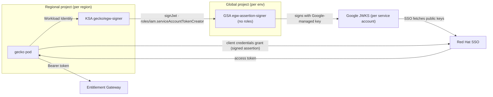

# EGW Service Identity: Client Credentials with Google-Managed Key Signing

***Scope***: GCP-HCP

**Date**: 2026-11-06

## Decision

Gecko authenticates to the Entitlement Gateway (EGW) using the OAuth2 client credentials grant with a Private Key JWT client assertion. Assertions are signed with the Google-managed keys of a dedicated, permissionless service account, and SSO verifies them against Google's published JWKS. Each environment gets its own SSO client and its own signer service account, so each environment is isolated by its own identity.

## Design Elements

**D1 — Protocol.** OAuth2 client credentials grant with Private Key JWT client authentication. Gecko presents the resulting short-lived Bearer token to EGW.

**D2 — Identity model.** One Red Hat Central service account per environment, requested via a ServiceNow ticket under the CIAM external SSO enablement process. Per CIAM guidance, all clients — including non-production — are created in the production SSO, with environments isolated by separate clients.

**D3 — Key custody.** Assertions are signed with a Google-managed service account key via IAM Credentials `signJwt`; SSO verifies signatures against Google's per-service-account JWKS endpoint. No key material is held or distributed by the platform.

**D4 — Placement and access.** The signer is a dedicated service account in the environment's global project and holds no roles. Signing access is granted to gecko's Kubernetes workload identities per regional cluster, via `roles/iam.serviceAccountTokenCreator` on the signer, declared by each region's Terraform following the established per-region grant pattern.

**D5 — Credential lifecycle.** Key rotation is owned by Google. Revoking a consumer is removing its grant on the signer: once propagated, no new assertions can be signed, while already-signed assertions and issued tokens remain valid until they expire — residual access is bounded by the assertion validity, which SSO must enforce server-side (RFC 7523 permits rejecting distant `exp`), and the short access-token lifetime. Containment beyond that window is disabling the client at CIAM. Recovering from the loss of the signer is recreating it — same service-account email and JWKS URL, new keys, grants restored by Terraform. Signing calls are recorded in Cloud Audit Logs, provided Data Access logs are enabled for the IAM API (`iam.googleapis.com`) or all services.

## Context

- **Problem Statement**: gecko must call EGW read APIs to resolve GCP subscriptions and entitlements; the service identity it uses, and that identity's credential lifecycle, needed to be defined.
- **Constraints**: the identity must be a Red Hat service account managed by CIAM; the platform must not hold, distribute, or rotate credential material; the solution must follow existing infra patterns (workload identity, per-consumer cross-project IAM grants, no custom roles).
- **Assumptions**: CIAM can enable a Central SA with Signed JWT client authentication verified against a Google JWKS URL. This is a dependency on CIAM: their enablement process documents only secret-based clients, so it must be confirmed in the ServiceNow ticket. If Signed JWT is not supported at all, this decision must be revisited.

## Alternatives Considered

1. **Organizational service accounts**: rejected — self-service clients scoped to an SSO organization; they do not support Signed JWT (JWKS) client authentication, and credential rotation means replacing the account, so the `client_id` is not stable.
2. **PKI client certificates (mTLS)**: rejected — adds a certificate lifecycle (issuance, distribution, renewal, revocation) and credential material in the platform.
3. **Client secret**: rejected — requires generating, distributing, storing, and rotating a secret in the platform.
4. **Self-managed signing keypair**: rejected as the primary approach — the platform would generate the key pair, store the private key in Secret Manager, distribute it to clusters via External Secrets, and publish the public key for SSO; all consumers share one key, so revocation is all-or-nothing. It remains the fallback if CIAM cannot verify against Google's JWKS URL.

## Decision Rationale

* **Justification**: no secret or key material is held, distributed, or rotated anywhere in the platform; revocation granularity is per consumer rather than per credential; and the access model reuses established infra patterns unchanged.
* **Evidence**: a [POC](https://github.com/openshift-online/gcp-hcp/pull/169) with a local Keycloak 26.8 validated claim preservation, verification against Google's JWKS, token issuance, and recovery from a simulated unknown key; Google publishes a key for a new signer immediately. Central SSO enablement — accepting Google's JWKS URL and equivalent refetch behaviour — remains a deployment prerequisite.
* **Comparison**: every rejected alternative requires holding key or secret material and adds rotation procedures; only the self-managed keypair offers custody independent of Google, at the cost of all-or-nothing revocation.

## Consequences

### Positive

* No credentials at rest in the platform; nothing to leak or rotate.
* Onboarding or revoking a region is a single IAM binding change, declared in that region's Terraform.
* Recovery from signer loss requires no CIAM coordination — the recreated signer keeps its email and JWKS URL, and Terraform restores its grants.
* Every signing call is authorized individually and recorded in Cloud Audit Logs.

### Negative

* Token refresh depends on the IAM Credentials API, SSO, and Google's JWKS endpoint; if refresh is unavailable when the cached token expires, EGW reads fail until it recovers.
* Non-production environments issue their tokens from the production SSO, coupling them to its availability.

## Cross-Cutting Concerns

### Security:

* Least privilege: the signer holds no roles; grants are per regional workload identity, using a predefined role; no custom roles introduced.
* No key or secret material exists on the platform side; compromise of a consumer is contained by removing its grant, with residual access bounded by the assertion and token lifetimes (see D5).

### Reliability:

* A refresh outage is tolerated only until the cached token expires — the short lifetime bounds the grace window, not the outage.
* Signer recovery is recreation in place — same service-account email and JWKS URL, new keys, grants restored by Terraform — with no external coordination.

### Operability:

* The signer and its grants are Terraform-declared, one binding block per region. The SSO client is a one-time ServiceNow request; nothing about it needs rotation or renewal.

---

Implementation details — assertion construction, token caching and refresh, retry behavior, audit log enablement, endpoints, and EGW `auth.yaml` matching — are out of scope here and tracked separately in an implementation plan.
