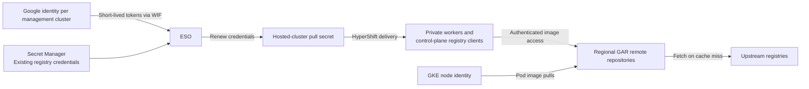

# Deliver OpenShift Release Images Through GAR Without Public Worker Egress

***Scope***: GCP-HCP

**Date**: 2026-10-23

**Status**: Proposed — based on a development POC, with production safeguards and validation included in the proposed work.

**Related work**: [GCP-738](https://redhat.atlassian.net/browse/GCP-738), [GCP-1268](https://redhat.atlassian.net/browse/GCP-1268), [GCP-1276 investigation](https://redhat.atlassian.net/browse/GCP-1276).

## Decision

Deliver OpenShift release images through regional Google Artifact Registry (GAR) remote repositories, without public worker egress. Use External Secrets Operator (ESO) and Workload Identity Federation (WIF) to renew short-lived credentials for consumers that require pull secrets, with a Google identity per management cluster.

## Context

Private hosted-cluster workers must bootstrap, scale and upgrade without external IPs or Cloud NAT. The existing image-distribution approach covers management-cluster Pod pulls through native GKE identity, but worker runtimes and application registry clients also need access to GAR. Some of these consumers require Docker credentials and cannot use Google identity directly.

- **Scope:** OpenShift release-image delivery to hosted control planes and workers. Customer workload images, complete Operator Hub and layered-product coverage, build-pipeline changes and full management-cluster egress restriction are outside this proposal.
- **Constraints:** No service-account JSON keys. Workers retain required Google API, DNS and cluster connectivity through private access. GAR can fetch upstream content on cache misses; this is not an offline image inventory.
- **Compatibility:** Existing clusters must remain usable during migration. Routine credential renewal must not replace worker VMs.
- **Assumptions:** Supported ESO, HyperShift and OpenShift versions can generate and deliver credentials within their validity window. Native GKE identity remains available for management-cluster Pod pulls.

### Proposed approach

1. **Regional image sources:** Use one GAR remote repository per upstream registry, initially Quay and Red Hat, with explicit routing for each consumer. Retain native GKE authentication for management-cluster Pod pulls.
2. **Keyless renewal:** ESO uses WIF and a per-management-cluster Google download identity to generate GAR tokens. It combines these with existing registry credentials in a separate hosted-cluster pull secret, alongside the original. Generated tokens live in Kubernetes, not Secret Manager.
3. **Credential delivery:** Gecko prepares the hosted-cluster resources and opt-in configuration. HyperShift delivers refreshed credentials to control-plane consumers, existing workers and new-worker bootstrap. Reload-capable consumers adopt updates without routine Pod replacement.

## Alternatives Considered

| Approach | Assessment |
| --- | --- |
| **Regional remote repositories + ESO/WIF pull-secret renewal** | **Proposed.** Reuses existing identity, secret-generation and delivery capabilities while supporting consumers that require Docker credentials. |
| Native identity for every consumer | Preferred where supported. Evaluate worker credential providers and identity-aware registry clients to remove distributed GAR tokens, including mirror authentication, bootstrap and supported-release integration. |
| Virtual repository over remote repositories | Tested in the POC; excluded from this proposal to follow the existing image-distribution decision. Validate equivalent image access through direct regional remotes before rollout. |
| Custom token service or runtime credential helper | Adds a service or runtime integration to own and support. Defer unless existing capabilities cannot meet lifecycle requirements. |
| Long-lived Google service-account keys | Rejected: violates the keyless identity requirement and introduces persistent key management. |
| Longer-lived tokens or manual rotation | A longer lifetime may increase the recovery window, but does not remove churn at an unchanged renewal frequency. Manual rotation is a recovery tool, not a replacement for automated renewal. |

## Decision Rationale

**Justification:** The proposal extends existing GAR infrastructure and HyperShift credential delivery rather than requiring every consumer to adopt a new authentication interface. ESO already provides token generation, avoiding a separate token service. Regional repositories and per-management-cluster identities avoid cross-management-cluster credential dependencies.

**Evidence:** The development POC demonstrated private-worker bootstrap and scaling across credential renewals, and overnight renewal with unchanged OpenShift API server Pod identities and zero container restarts. These development observations support feasibility. Extend validation to the proposed direct regional repositories and representative operating conditions before production rollout. Detailed measurements and implementation findings belong to the POC record.

**Comparison:** Native identity avoids distributing tokens and is a future direction for workers and registry clients. Use the pull-secret approach as an incremental bridge, with the lifecycle safeguards and operational improvements below forming part of implementation.

## Consequences

### Positive

- Release images can reach private workers without worker external IPs or Cloud NAT.
- Keyless renewal reuses existing platform capabilities and preserves existing registry credentials.
- Infrastructure preparation and consumer activation can proceed incrementally, with fewer token-driven Pod and VM rollouts.

### Negative

- **Credential lifecycle:** Expiry enforcement and outage recovery need attention during design. Define expiry-aware delivery, freshness alerts and a bounded recovery budget across Google identity services, ESO and HyperShift.
- **Worker disruption:** Worker kubelet service restarts might occur on renewal. Investigate credential reload without service restarts and assess workload impact during design.
- **Image-access reliability:** Worker egress restrictions require monitoring of GAR connectivity and image-pull failures.
- **Release compatibility:** Credential handling varies across components and releases. Validate adoption, bootstrap and upgrades on each supported release before activation.
- **Shared authorization:** A per-management-cluster identity spans its opted-in hosted clusters. Limit access to registry reads, scope hosted-cluster identity bindings and review whether stronger isolation requires separate identities.

## Cross-Cutting Concerns

### Reliability

- Track actual token expiry and delivery freshness, with monitoring and a recovery budget that covers generation, propagation and bootstrap. Prevent provisioning with insufficient credential validity; retaining the last complete Secret must not conceal expiry.
- Include renewal, source and delivery failure recovery, and credential adoption under worker egress restrictions in release acceptance. Preserve complete credentials during failures and enforce their expiry; evaluate worker reload changes for workload impact.
- Confirm the behavior on supported releases, including bootstrap, scaling, upgrades and rollback. Measure fleet-scale API demand and reconciliation latency before expansion.

### Security

Use narrowly scoped hosted-cluster WIF bindings and read-only GAR access. Keep Secret Manager access separately authorized through namespace-scoped SecretStores, consistent with the secret-management decision. Record credential ownership in the secret inventory and protect runtime tokens as bearer credentials. Verify that worker network restrictions prevent direct upstream access while preserving required private connectivity.

### Operability

- **Ownership:** Infrastructure manages repositories and shared identities; Gecko manages hosted-cluster configuration and resources; ESO generates credentials; HyperShift delivers them. Hosted-cluster teardown must remove its resources and identity bindings while preserving shared infrastructure.
- **Activation:** Prepare resources before opting in consumers. Add independent worker activation to support worker-first rollout, since the current shared pull-secret selection also affects control-plane consumers. Review migration and fleet rollout impact; routine token bytes must remain outside worker replacement triggers.
- **Rollback:** Restore image routing and credential selection together, and keep renewal running until the replacement path is authenticated and reachable. Validate this coordinated rollback on canaries before wider activation.

### Cost

- **GAR:** Budget for cache storage and applicable data transfer. [Pricing](https://cloud.google.com/artifact-registry/pricing).
- **Credential retrieval:** Google IAM token-generation API calls are currently free; account for API quotas as the fleet grows. [Pricing](https://cloud.google.com/iam/pricing).

## Related Decisions

- [Image build and distribution](../automation/container-image-build-and-distribution-pipeline.md): extends regional remote repositories to additional consumers; preserves the build pipeline and exclusion of virtual repositories.
- [Workload Identity](../identity/workload-identity-implementation.md) and [secret management](../identity/secret-management-strategy.md): apply keyless authentication, scoped access and namespace isolation.
- [Regional independence](regional-independence-architecture.md): regional caches and independent management-cluster credential generation; uncached images still depend on upstream availability.
- [Deployment swim lanes](../automation/deployment-tooling-swim-lanes.md): retain existing infrastructure, GitOps and controller ownership boundaries.

## Supporting Material

The POC working document `GAR-POC-OVERVIEW.md` contains implementation details, measurements, open investigations and the delivery breakdown. [GCP-1276](https://redhat.atlassian.net/browse/GCP-1276) tracks the investigation; publish reproducible evidence before production activation.

Prototype code snapshots: [Gecko](https://github.com/daniel-rejniak/gecko/commit/f65b38073d731fa13eec3513f6084a89a61754e3), [HyperShift credential delivery](https://github.com/daniel-rejniak/hypershift/commit/472dc51313d1a06ed0082ffd8f086b3503aa6da6), [API server reload](https://github.com/daniel-rejniak/hypershift/commit/bdf9b66b5af9e10be3a96e8cd966b1130ec7d8f7), [worker syncer](https://github.com/daniel-rejniak/hypershift/commit/54de435a8), [infrastructure](https://github.com/daniel-rejniak/gcp-hcp-infra/commit/70e5ef959fdd1297da381750b3eeb4241270ae1d). These are development implementations, not merged upstream changes or measurement records.
