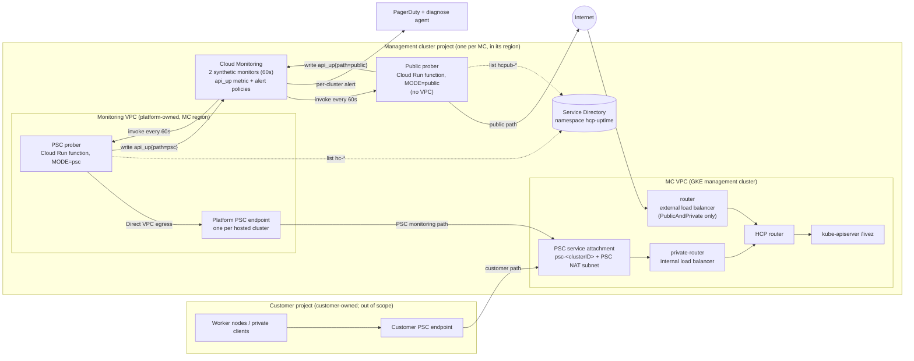
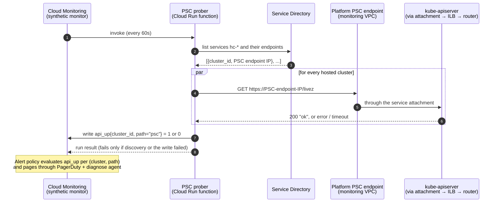

# Hosted Cluster API Availability via Batched Synthetic Monitors

***Scope***: GCP-HCP

**Date**: 2026-11-13

**Jira**: [GCP-346](https://redhat.atlassian.net/browse/GCP-346) (Spike) under [GCP-335](https://redhat.atlassian.net/browse/GCP-335) (Epic)

## Decision

Monitor every hosted cluster's kube-apiserver `/livez` with Cloud Monitoring synthetic monitors. Each management cluster runs two of them:

- **PSC prober (every hosted cluster):** probes each cluster through a platform-owned Private Service Connect endpoint.
- **Public prober (PublicAndPrivate clusters only):** probes each cluster's public API endpoint.

Both probers discover their targets from Service Directory, which Gecko populates with Config Connector resources. Each writes a per-cluster availability metric, `custom.googleapis.com/hcp/api_up{cluster_id, path}`, and one alerting policy per management cluster raises a separate alert for each failing cluster and path.

## Context

- **Problem Statement**: We have no external, Red Hat-owned signal that a hosted cluster's API server is reachable. We need to learn that a cluster's API is unavailable before the customer does, and to report availability per cluster over time ("cluster X had Y% API availability this month"). Private clusters must be covered over the private network, using Google Cloud services.
- **Constraints**:
  - **Google Cloud native.** Cloud Monitoring synthetic monitoring and alerting. No in-cluster probing (blackbox exporter / Prometheus `probe_success`).
  - **Responsibility boundary.** The customer project is Red Hat's zero-responsibility line. Failures anywhere on Red Hat's side (management cluster, private router, internal load balancer, PSC service attachment and NAT, kube-apiserver) must be detected. Failures inside the customer project (their PSC endpoint, DNS) are out of scope.
  - **Every region.** Management clusters will exist in every GCP region, so the design cannot depend on region-specific behaviour.
  - **No globally reachable internal load balancers.** Enabling internal load balancer global access on every hosted cluster's private router is expected to meet security pushback.
  - **Per-cluster signal.** Availability must be queryable per cluster ID, and alerts must be per cluster, never merged across clusters.
  - **Cost.** Monitoring cost must stay small relative to the revenue of small clusters.
  - **Scale.** Up to 100 hosted clusters per management cluster (one GCP project and one GKE cluster per management cluster).
- **Assumptions**:
  - Every hosted cluster, in both endpoint access modes, has a PSC service attachment named `psc-<clusterID>` in the management cluster project. HyperShift creates it today.
  - `/livez` on the hosted cluster's kube-apiserver answers anonymously with `200 ok`. Verified on OCP 5.0.0-ec.6.
  - **Endpoint choice: `/livez`.** It reports whether the API server process is healthy, and it doesn't fail on purpose during graceful shutdown the way `/readyz` does. That avoids false outages when a probe hits a terminating replica during a rolling restart. It is also the conventional external liveness endpoint for hosted control planes.
  - The public API hostname is `api.<clusterName>-<slug>.<baseDomain>`, which Gecko already builds when creating the cluster.
  - Config Connector runs in cluster mode on each management cluster, with an identity that can manage compute, Service Directory and monitoring resources in the management cluster project.

## Alternatives Considered

1. **Per-cluster uptime check on the public endpoint**: one Cloud Monitoring uptime check per PublicAndPrivate cluster, from three Google regions. Works, and alerts in about 3.5 minutes. Does not cover Private clusters. Costs about $39 per cluster per month.
2. **Per-cluster private uptime check on the private-router internal load balancer**: an uptime check with `checkerType: VPC_CHECKERS` targeting each cluster's internal load balancer through Service Directory.
   - Works only when internal load balancer global access is enabled, and HyperShift does not enable it. That would be needed on every hosted cluster in every region outside the six regions where Google runs private checkers.
   - Blind to failures in Red Hat's PSC data path.
   - About $39 per cluster per month.
   - Config Connector cannot express private uptime checks.
3. **Per-cluster private uptime check through a platform-owned PSC endpoint**: not viable. Cloud Monitoring private checkers cannot reach PSC consumer endpoints (they time out), even with PSC global access, although VMs in the same VPC reach the endpoint from any region.
4. **Per-cluster synthetic monitors**: one Cloud Run function and monitor per cluster. Reaches PSC endpoints, but costs about $52 per cluster per month and needs one deployed function per cluster.
5. **Batched synthetic monitors per management cluster (chosen)**: one PSC prober and one public prober per management cluster, each probing all of that management cluster's hosted clusters every minute and writing a per-cluster metric.
6. **Batched synthetic monitor, load balancer direct (no PSC endpoints)**: the PSC prober uses Direct VPC egress into the **MC's own VPC** and probes each cluster's private-router internal load balancer in the same region.
   - **No global access needed:** it is only required for clients in other regions.
   - **No per-cluster resources:** clusters are discovered from the MC's internal forwarding rules, whose GKE description names `clusters-<clusterID>-<name>/private-router`. Each cluster's hostname is read from its internal serving certificate, which lists `api.<name>-<slug>.<baseDomain>`. So there are no PSC endpoints, no Service Directory entries and no Gecko change.
   - **Coverage:** detects API and router outages like alternative 5, but **misses Red Hat-side PSC data-path failures** (tested, see Evidence).
   - **Cost:** about $1.20 per cluster per month, against about $8.50 for alternative 5.
7. **In-cluster probing (e.g. blackbox exporter)**: excluded by the Google-native constraint, and it would not exercise Red Hat's PSC path.

## Architecture

### Network paths

A hosted cluster's kube-apiserver is reachable three ways. The customer owns one; Red Hat owns the other two.

* **Customer private path** (customer-owned, out of scope): the customer's PSC endpoint in *their* VPC connects to the cluster's PSC service attachment. Worker nodes and private clients use this path.
* **PSC monitoring path** (this design): a separate **monitoring VPC** that Red Hat owns in the management cluster project. It holds **one platform-owned PSC endpoint per hosted cluster**, each connected to the *same* service attachment the customer's endpoint uses. The PSC prober reaches it through Direct VPC egress, so it exercises Red Hat's whole side of the private path without touching the customer project:
  1. PSC endpoint
  2. service attachment and PSC NAT
  3. private-router internal load balancer
  4. router
  5. kube-apiserver
* **Public path** (PublicAndPrivate clusters only): over the internet to the cluster's public load balancer.



**Who creates what:**
* **Gecko** ships per-cluster Config Connector resources for the platform PSC endpoint (`ComputeAddress` + `ComputeForwardingRule`) and the Service Directory entries.
* **HyperShift** creates the service attachment and the internal and external load balancers, and accepts the monitoring VPC on the attachment.
* **Terraform** creates the monitoring VPC, the two functions, the synthetic monitors and the Service Directory namespace.

### One probe run (PSC prober)



The public prober is the same, except it lists `hcpub-*` services and calls `https://api.<clusterName>-<slug>.<baseDomain>/livez` over the internet.

### Components

| Component | Owner / mechanism | Per |
|---|---|---|
| Monitoring VPC + subnet (MC region), probers' service accounts, Cloud Run functions, synthetic monitors, Service Directory namespace `hcp-uptime` | Terraform, `terraform/modules/management-cluster` (gcp-hcp-infra) | MC |
| Prober source (one codebase, `MODE=psc\|public`) | Node.js function source in gcp-hcp-infra (`functions/hc-api-prober`), unit-tested; Terraform deploys it as a 2nd gen Cloud Run function. Synthetic monitors require the Node.js runtime and functions built from source, not container images, so this is not a Konflux image. | — |
| PSC endpoint (`ComputeAddress` + `ComputeForwardingRule` → `psc-<clusterID>`), Service Directory service `hc-<clusterID>` + endpoint (`addressRef` → the address) | Config Connector resources shipped by Gecko with the hosted cluster manifests; removed with the cluster | HC |
| Service Directory service `hcpub-<clusterID>` + address-less endpoint named `<clusterName>-<slug>` | Config Connector, shipped by Gecko for PublicAndPrivate clusters only | HC |
| Service attachment accept list includes the MC project | HyperShift change (upstream PR) | HC |
| Alerting policy on `api_up` | `MonitoringAlertPolicy` via Config Connector/ArgoCD, per the [integrated alerting framework](integrated-alerting-framework.md) | MC |

### Lifecycle

1. Gecko creates a hosted cluster and ships its manifests, now including the PSC endpoint and Service Directory resources above.
2. HyperShift creates the service attachment `psc-<clusterID>` and accepts the platform project. Config Connector retries until the attachment exists, then the PSC connection is accepted and Service Directory holds the endpoint IP.
3. The next prober run (≤ 60s) discovers the cluster and starts writing `api_up` for it.
4. On deletion, Gecko's existing cleanup removes the Config Connector resources, so the cluster disappears from the probers' target lists. No per-cluster Monitoring objects need to be created or deleted.

### Signal and reporting

* **Metric**: `custom.googleapis.com/hcp/api_up` (gauge, 1/0) with labels `cluster_id` (HyperShift `spec.clusterID`), `path` (`psc` | `public`) and `management_cluster`, on monitored resource `global`. Up means HTTP 200 with body `ok`; the probe timeout is 5s. Endpoint IPs are deliberately not labels, so a cluster's history never splits.
* **Per-cluster availability** (PromQL, usable from Grafana):
  ```promql
  avg by (cluster_id, path) (
    avg_over_time({"__name__"="custom.googleapis.com/hcp/api_up","monitored_resource"="global"}[30d]))
  ```
* **Prober health**: a run fails only when discovery or the metric write fails, never because a cluster is down. Each monitor's own `uptime_check/check_passed` drives a separate "prober unhealthy" alert, so a broken prober is never mistaken for healthy clusters.

### Alerting

* One `MonitoringAlertPolicy` per MC project: `api_up` minimum < 1 for 60s, grouped by `cluster_id` and `path`. Cloud Monitoring opens one alert per (cluster, path). A PublicAndPrivate cluster whose API is fully down produces two alerts.
* Alerts carry `cluster_id` and `path` as labels, and the policy documentation templates `${metric.label.cluster_id}`.
* **Routing**: both paths page (PagerDuty critical) and trigger the diagnose agent, following the [integrated alerting framework](integrated-alerting-framework.md).
* The "prober unhealthy" policy routes to the same channels.
* **Alert latency (~4–5.5 min)**: up to 60s until the next probe run, plus a 60s policy duration (effectively two consecutive failed probes), plus about 2 min of Cloud Monitoring ingestion and alert evaluation, which we can't tune. With `/livez`, a full outage also shows ~1–2 min later than with `/readyz`, because `/livez` keeps answering `200 ok` on a kube-apiserver replica that is gracefully shutting down. That is the intended noise reduction.
  * Measured: 3m56s with `/readyz` (outage 15:07:04, alert 15:11:00) and 5m32s with `/livez` (outage 19:12:30, first steady failure 19:14, alert 19:18:02).
  * Setting the duration to 0s would page on a single failed probe, which is too noisy given frequent cluster state changes.
* SLO targets and burn-rate alerting are out of scope; they belong in a separate SLO decision that consumes `api_up`.

## Decision Rationale

* **Justification**:
  * This is the only option that meets every constraint at once:
    * detects Red Hat-side failures, including the PSC data path;
    * works in every region without internal load balancer or PSC global access;
    * gives per-cluster metrics and alerts;
    * costs about $1 per hosted cluster per month.
  * Discovery through Service Directory and Config Connector means no per-cluster Monitoring objects, so the 100 uptime-checks-per-project quota does not apply and there is no create/delete lifecycle to get wrong.
* **Evidence** (GCP-346 spike, dev environment in northamerica-northeast2, 2026-11-12/13):
  * `/livez` and `/readyz` both answered anonymously `200 ok` on both access modes. The spike's probers measured `/readyz`. Every injected failure took the API fully down or cut the network path, so `/livez` would have failed identically. Probers will use `/livez`.
  * Detection by the batched probers, measured from the start of each injected failure to the alert opening:

    | Injected failure | Alerts | Time to alert |
    |---|---|---|
    | kube-apiserver scaled to 0 (Private cluster) | `{cluster, psc}` | 3m56s |
    | Red Hat-side PSC NAT path blocked | `{cluster, psc}`, only the affected cluster | 5m33s (delayed by a prior open alert) |
    | Public load balancer blocked | `{cluster, public}` only; the PSC path stayed healthy | 4m36s |
    | kube-apiserver down (PublicAndPrivate cluster) | separate `{cluster, psc}` and `{cluster, public}` | 4m09s / 4m38s |

  * The private uptime check on the internal load balancer (alternative 2) **did not detect** the PSC NAT failure. It also failed (`VPC_REQUEST_TIMEOUT`) until global access was enabled by hand.
  * Private uptime checks against a PSC endpoint (alternative 3) timed out from every checker region, with and without PSC global access. Diagnostic VMs in the same VPC reached the endpoint from the same region and from us-central1.
  * Config Connector created the PSC endpoint and Service Directory entry end to end. `ComputeForwardingRule` needs `ipAddress.addressRef.external` set to the address URL; a name reference resolves to the raw IP and the API rejects it with a 400. The PSC connection was accepted once the MC project was on the attachment's accept list.
  * Per-cluster availability PromQL returned the expected values for both test clusters. Alerts carried `cluster_id` and `path`.
  * **Load balancer direct (alternative 6), tested with global access off on every ILB:**
    * Discovery from forwarding rules, hostnames from the internal cert, and full TLS verification all worked.
    * It detected the API outage (5m32s) and the router outage (5m25s), at the same instant as the PSC prober.
    * It **missed** the Red Hat-side PSC NAT failure, which the PSC prober caught (5m12s).
  * **Passive PSC producer metrics don't show that failure.** During the PSC NAT block, the per-attachment `dropped_received_packets_count` and `dropped_sent_packets_count` stayed 0, and new and open connections looked normal. Passive metrics can't replace an active PSC probe.
  * **Certificates can be checked on both paths.** Sending the cluster's hostname (SNI) through the private load balancer or PSC returns the cluster's publicly trusted certificate, which verifies fully. A wrong cluster returns the internal `kubernetes` certificate, so hostname verification catches stale or mis-routed targets.
  * **Probers must open a fresh connection per probe** (no keep-alive, no TLS session cache). A resumed TLS session returns an empty peer certificate. That caused false failures in a spike prober, including a false alert on an untouched cluster, until each probe was given a fresh agent. Reusing connections can also hide failures that only affect new connections.
* **Comparison**:

  | | Private clusters | RH-side PSC failures | Every region w/o global access | Per-cluster objects | Cost / HC / month |
  |---|---|---|---|---|---|
  | 1. Public uptime check | no | no | yes | uptime check | ~$39 |
  | 2. Private uptime check → ILB | yes | **missed** | **no** (needs ILB global access) | uptime check + SD (not expressible in KCC) | ~$39 |
  | 3. Private uptime check → PSC | — | — | — | not viable | — |
  | 4. Per-cluster synthetic monitor | yes | yes | yes | function + monitor | ~$52 |
  | **5. Batched synthetic monitors (PSC)** | **yes** | **yes** | **yes** | **KCC PSC endpoint + SD entries** | **~$8.50** |
  | 6. Batched synthetic monitor, LB direct | yes | **missed** (also not visible in PSC metrics) | yes | none (public prober still needs SD entry) | ~$1.20 |
  | 7. In-cluster probing | — | no | yes | — | excluded |

## Consequences

### Positive

* Red Hat learns about API outages on either path within about 4–5 minutes, per cluster, before customers report them. This includes Private clusters, probed over the private network.
* Covers Red Hat-side PSC failures (attachment, NAT, firewall). For PublicAndPrivate clusters it also covers the node-to-control-plane PSC path, which a public-only check would miss.
* No internal load balancer global access, and no per-cluster Monitoring objects, quota or lifecycle.
* About $8.50 per hosted cluster per month (about $8,500 per 1,000 clusters), dominated by the per-cluster PSC endpoints, against about $55 per cluster with per-cluster uptime checks. See Cost.
* One metric gives per-cluster availability reporting, dashboards and alerting.
* Everything per-cluster is created by Config Connector through Gecko's existing manifest transport.

### Negative

* We own prober code (discovery, probing, metric writes), with its tests, releases and on-call runbook, where uptime checks would have been configuration only.
* Probes come from a single location, the MC's region. A regional Google Cloud problem could look like an outage. This is accepted for simplicity, and the prober-health alert helps distinguish the two.
* Alert latency is about 4–5.5 minutes (60s probes, Cloud Monitoring evaluation, and `/livez` staying healthy during graceful shutdown), roughly 1–2 minutes slower than uptime checks.
* Requires an upstream HyperShift change: the MC project on each service attachment's accept list.
* Adds one PSC endpoint, and one IP in the monitoring subnet, per hosted cluster.
* Config Connector lacks Service Directory annotations, so the public prober depends on a naming convention (endpoint name `<clusterName>-<slug>`) plus a per-MC `BASE_DOMAIN`.
* If a region has more than one base domain, discovery must learn each cluster's domain (open question below).
* The availability metric is self-written. Missing data (prober down) must be treated explicitly in reporting rather than read as up or down.

## Cross-Cutting Concerns

### Reliability:

* **Scalability**:
  * Work per run grows linearly with hosted clusters per MC (≤ 100). Probes run in parallel with a 5s timeout; a 2-cluster run took about 1s.
  * The monitoring subnet needs one IP per hosted cluster (a /24 suffices for 100).
  * Limits: 1,000 simultaneously open alerts per policy, which is why there is one policy per MC; 30 labels per custom metric; 200k active series per custom metric on `global`.
* **Observability**:
  * Per-cluster `api_up` series.
  * Structured prober logs per target (cluster, target, status, latency).
  * The synthetic monitors' own pass/fail and run logs.
  * A "prober unhealthy" alert.
* **Resiliency**:
  * Probers are stateless and re-discover targets on every run.
  * A failed run does not hide cluster health: it fires the prober-health alert.
  * Cloud Run retries and scheduling are managed by Cloud Monitoring.

### Security:

* Prober service accounts get only `roles/servicedirectory.viewer` and `roles/monitoring.metricWriter`.
* Probers are invoked only by the Monitoring service agent (`roles/run.invoker`); there is no unauthenticated access.
* Function builds use a dedicated build service account, not the default compute account, which stays disabled.
* The monitoring VPC is platform-owned and contains only PSC endpoints and the probers' egress. Nothing in the customer project is touched.
* The accept-list change only lets the MC project connect to its own attachments. It stays `ACCEPT_MANUAL`, and the customer's connection is unaffected.
* Probes are anonymous `GET /livez`; no credentials are needed or stored.
* The public prober verifies TLS, so certificate failures count as down.

### Cost:

Estimates for **1,000 hosted clusters** (10 MCs × 100), half of them PublicAndPrivate, all checks every 60s:

| | Uptime checks (alt. 1/2) | **PSC model (chosen, alt. 5)** | LB direct (alt. 6) |
|---|---|---|---|
| Probing | 1,500 checks × 3 regions ≈ $55,300 | 2 synthetic monitors × 10 MCs = $1,037 | $1,037 |
| Per-cluster PSC endpoints | — | 1,000 × ~$7.30 ≈ **$7,300** ⚠️ | — |
| Cloud Run compute | — | ~$10 | ~$10 |
| Custom metric `api_up` (~495 MiB/month) | — | ~$90–130 | ~$90–130 |
| Alerting (estimate) | small | ~$30 | ~$30 |
| **Total / month** | **≈ $55,300** | **≈ $8,500 (≈ $8.50/HC)** | **≈ $1,200 (≈ $1.20/HC)** |

* Synthetic monitors cost $1.20 per 1,000 executions, billed per execution regardless of how many clusters are probed. Uptime checks cost $0.30 per 1,000 executions per region.
* ⚠️ The PSC endpoint price (~$0.01 per endpoint-hour) is **not yet verified** against Google's pricing page. It is ~85% of the PSC model's cost. PSC data processing is negligible (~300–400 GB per month across the fleet).
* Custom metrics are billed by ingested bytes (~8 bytes per point). The free ingestion tier is shared across the billing account, so it is not counted on.
* Alternative 1/2's private-path checks also need ILB global access, so they are shown for comparison only.
* The PSC model costs ~$7,300 per month more per 1,000 clusters than LB direct. That is the price of actively probing Red Hat's PSC path.

### Operability:

* Adding a hosted cluster requires no monitoring-specific action. Monitoring follows Gecko's manifests.
* The prober source lives in gcp-hcp-infra with pinned dependencies (`package-lock.json`). Terraform builds and deploys it per MC (dedicated build service account), and changes roll out through the normal Terraform promotion pipeline.
* Runbook: per-(cluster, path) alerts link to prober logs; the `path` label tells PSC (Red Hat side) from public (public LB/DNS/certificate) failures.

## Resolved

* **Prober runtime and packaging (2026-11-13):** synthetic monitors only support 2nd gen Cloud Run functions on the Node.js runtime, created from source (Google docs: the runtime "is restricted to" Node.js). We follow Google's generic "Custom synthetic monitor" template in Node.js rather than a Go/Konflux image behind Cloud Scheduler, to stay on Google's purpose-built synthetic monitoring service. Implementation: openshift-online/gcp-hcp-infra#2836.

## Open Questions

1. **PSC model vs. load balancer direct**: the PSC model actively covers Red Hat-side PSC failures for ~$7.30 more per cluster per month. Load balancer direct needs no per-cluster resources, no PSC endpoints and no HyperShift accept-list change, but misses that failure class, and PSC producer metrics don't reveal it either. This doc chooses the PSC model; revisit if cost outweighs PSC coverage.

2. **Multiple base domains per region/MC**: can one MC host clusters under more than one base domain? If so, public discovery must carry the domain per cluster instead of using a per-MC `BASE_DOMAIN`.
3. **HyperShift accept-list API shape**: an operator-level setting (e.g. "accept the attachment's own project") rather than a per-cluster field.

## References

* [Integrated Alerting Framework](integrated-alerting-framework.md)
* [Observability: Google Managed Prometheus](observability-google-managed-prometheus.md)
* [GCP Private Service Connect](../networking/gcp-private-service-connect.md)
* [Datastore transport (Gecko → MC manifests)](../networking/datastore-transport.md)
* Jira: GCP-346 (spike), GCP-335 (epic)
* Cloud Monitoring: [synthetic monitors](https://cloud.google.com/monitoring/synthetic-monitors), [private uptime checks](https://cloud.google.com/monitoring/uptime-checks/private-checks), [quotas](https://cloud.google.com/monitoring/quotas)
