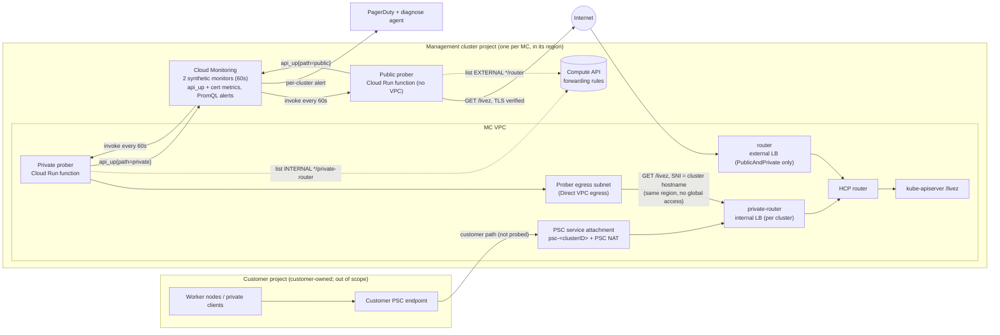
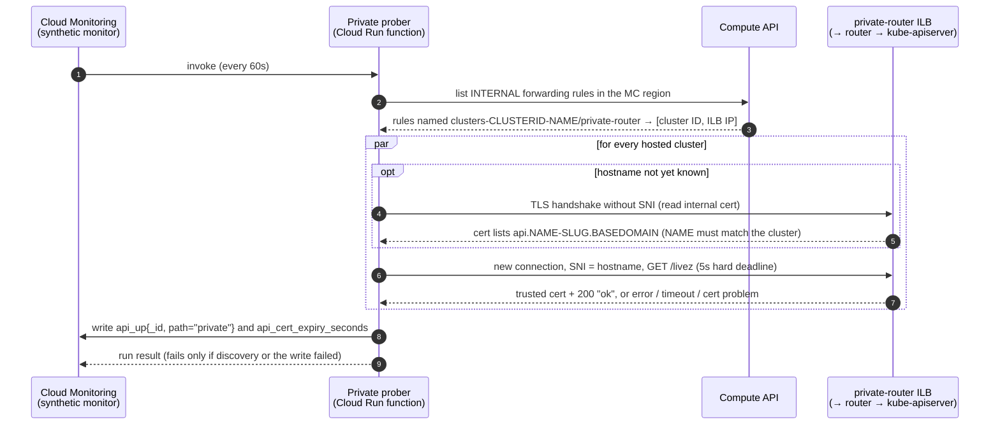

# Hosted Cluster API Availability via Batched Synthetic Monitors

***Scope***: GCP-HCP

**Date**: 2026-11-13

**Jira**: [GCP-346](https://redhat.atlassian.net/browse/GCP-346) (Spike) under [GCP-335](https://redhat.atlassian.net/browse/GCP-335) (Epic)

## Decision

Monitor every hosted cluster's kube-apiserver `/livez` with **two Cloud Monitoring synthetic monitors per management cluster (MC)**:

- **Private prober (every hosted cluster):** probes each cluster's private-router internal load balancer from inside the MC's own VPC, in the same region.
- **Public prober (PublicAndPrivate clusters only):** probes each cluster's public API endpoint over the internet.

Both probers discover clusters from the MC's forwarding rules and learn each cluster's API hostname from its serving certificate. That means **no per-cluster resources**: no PSC endpoints, no Service Directory entries, no Gecko or HyperShift changes. Every probe sends the cluster's hostname and fully verifies TLS. Results go to `custom.googleapis.com/hcp/api_up` and `custom.googleapis.com/hcp/api_cert_expiry_seconds`, labelled `{cluster_id, path, management_cluster}`. PromQL alert policies, following the [integrated alerting framework](integrated-alerting-framework.md), page once per failing cluster and path.

## Context

- **Problem Statement**: We have no external, Red Hat-owned signal that a hosted cluster's API server is reachable. We need to learn that a cluster's API is unavailable before the customer does, and to report availability per cluster over time ("cluster X had Y% API availability this month"). Private clusters must be covered over the private network, using Google Cloud services.
- **Constraints**:
  - **Google Cloud native.** Cloud Monitoring synthetic monitors (Google's purpose-built service) and alerting. No in-cluster probing (blackbox exporter / Prometheus `probe_success`).
  - **Responsibility boundary.** The customer project is Red Hat's zero-responsibility line. Nothing in the probe path may depend on customer-project resources.
  - **Every region.** MCs will exist in every GCP region, so the design can't depend on region-specific behaviour.
  - **No globally reachable internal load balancers.** Enabling ILB global access on every hosted cluster's private router is expected to meet security pushback.
  - **Per-cluster signal.** Availability must be queryable per cluster ID, and alerts must be per cluster, never merged across clusters.
  - **Low noise.** Clusters change state often. Probing must not page during expected transitions (creation, deletion, rolling restarts, silenced/limited-support clusters).
  - **Cost.** Monitoring cost must stay small relative to the revenue of small clusters.
  - **Scale.** Up to 100 hosted clusters per MC (one GCP project and one GKE cluster per MC).
- **Assumptions**:
  - `/livez` answers anonymously with `200 ok`, on both the private ILB and the public endpoint. Verified on OCP 5.0.0-ec.6.
  - **Endpoint choice: `/livez`.** It reports whether the API server process is healthy, and it deliberately stays healthy during graceful shutdown, which `/readyz` doesn't. That avoids false outages when a probe hits a terminating replica during a rolling restart. Whether an etcd-only outage turns `/livez` red is **not verified** for the tested build (upstream kube-apiserver registers an etcd check under `/livez`, but we didn't confirm it for 5.0.0-ec.6). See Open Questions.
  - GKE names each hosted cluster's load balancer forwarding rules with a description containing `networking.gke.io/service-name`:
    - `clusters-<clusterID>-<name>/private-router` for the internal LB, in both access modes;
    - `clusters-<clusterID>-<name>/router` for the external LB, PublicAndPrivate only.
  - The cluster's internal serving certificate lists `api.<clusterName>-<slug>.<baseDomain>` among its names. When that hostname is sent as SNI, the router serves the cluster's publicly trusted certificate (Let's Encrypt via cert-manager, 90-day duration, renewed at 30 days remaining).
  - HyperShift exports per-cluster metrics keyed by `_id` (= cluster ID): `hypershift_cluster_limited_support_enabled`, `hypershift_cluster_silence_alerts`, `hypershift_cluster_waiting_initial_availability_duration_seconds` and `hypershift_cluster_deleting_duration_seconds`. The existing `hcp:cluster:alertable` recording rule is built from the first two.

## Alternatives Considered

1. **Per-cluster uptime check on the public endpoint**: one Cloud Monitoring uptime check per PublicAndPrivate cluster, from three Google regions. Works, alerting in about 3.5 minutes, but doesn't cover Private clusters. About $39 per check per month.
2. **Per-cluster private uptime check on the private-router ILB**: an uptime check with `checkerType: VPC_CHECKERS`, targeting each cluster's ILB through Service Directory.
   - Google's private checkers run from fixed regions, so outside the six regions where Google documents this as working without global access, every ILB would need global access. HyperShift doesn't enable it.
   - About $39 per cluster per month.
   - Config Connector can't express private uptime checks.
3. **Per-cluster private uptime check through a platform-owned PSC endpoint**: not viable. In testing from the three US checker regions, Cloud Monitoring private checkers couldn't reach PSC consumer endpoints, with or without PSC global access, although VMs in the same VPC reached them from any region.
4. **Per-cluster synthetic monitors**: one Cloud Run function and monitor per cluster. Works, but about $52 per cluster per month and one deployed function per cluster.
5. **Batched synthetic monitors through platform-owned PSC endpoints**: a separate monitoring VPC holds one PSC endpoint per hosted cluster, connected to the cluster's service attachment, and the prober probes through it.
   - **Coverage:** the only option that actively probes Red Hat's PSC data path (service attachment, PSC NAT). Tested: it caught a Red Hat-side PSC NAT failure that every other option missed.
   - **Costs:**
     - a PSC endpoint, Service Directory entries and Config Connector resources per cluster, shipped by Gecko;
     - a HyperShift change to accept the monitoring VPC on every attachment;
     - about **$8.50 per cluster per month**, dominated by the PSC endpoints.
6. **Batched synthetic monitors, load balancer direct (chosen)**: as described in the Decision. No per-cluster resources, no HyperShift or Gecko changes, about **$1.30 per cluster per month**. It does not probe Red Hat's PSC data path (see Consequences).
7. **In-cluster probing (e.g. blackbox exporter)**: excluded by the Google-native constraint.

## Architecture

### Network paths



* **Private prober:** a Cloud Run function in the MC region with Direct VPC egress (`private-ranges-only`) into a small subnet in the **MC's own VPC**. It reaches each cluster's private-router ILB directly. ILB global access isn't needed, because the prober is in the same region.
* **Public prober:** a Cloud Run function with no VPC. It probes each PublicAndPrivate cluster's public hostname over the internet.
* **Not probed:** the PSC service attachment and PSC NAT, i.e. the customer's private path. See Consequences.

### One probe run (private prober)



The public prober is the same, except:
- it lists EXTERNAL `*/router` forwarding rules to find PublicAndPrivate clusters;
- it resolves each hostname from the matching cluster's internal certificate;
- it calls `https://api.<name>-<slug>.<baseDomain>/livez` over the internet.

### Components

| Component | Owner / mechanism | Per |
|---|---|---|
| Prober egress subnet in the MC VPC, prober service accounts, custom role (`compute.forwardingRules.list`), two Cloud Run functions, two synthetic monitors | Terraform, `terraform/modules/management-cluster` (gcp-hcp-infra) | MC |
| Prober source (one codebase, `MODE=private\|public`) | Node.js function source in gcp-hcp-infra (`functions/hc-api-prober`), unit-tested. Synthetic monitors require the Node.js runtime and functions built from source, not container images. | — |
| Alert policies (per-cluster, coverage, MC-wide, certificate, prober health) and the `hcp:cluster:probe_suppressed` recording rule | `MonitoringAlertPolicy` via Config Connector/ArgoCD in the alerting-policies chart, per the [integrated alerting framework](integrated-alerting-framework.md) | MC |
| GMP export allowlist entries for the HyperShift lifecycle metrics | `helm/charts/prometheus-hcp` (gcp-hcp-infra) | — |

Nothing is created per hosted cluster. A new cluster appears in the next run (≤ 60s) once GKE has created its load balancers, and disappears when they're deleted.

### Probe semantics

* **Up** = full TLS verification (chain, expiry, hostname) with SNI = the cluster's API hostname, **and** HTTP 200 with body `ok` from `/livez`.
* **Hostname identity:** the API hostname learned from the certificate must be `api.<name>-<slug>.<baseDomain>`, where `<name>` is the cluster name from the forwarding rule's namespace (`clusters-<clusterID>-<name>`). A load balancer that reaches another cluster presents that cluster's name, so it is reported down (`HOSTNAME_NOT_IN_CERT`) instead of being verified against the wrong cluster's valid certificate.
* Each probe has a **hard 5s deadline** (not a socket-idle timeout) and opens a **fresh connection** with no keep-alive and no TLS session cache. A resumed TLS session returns an empty peer certificate, and reused connections can hide failures that only affect new connections.
* One result per cluster per path per run. The failure reason (`TIMEOUT`, `ECONNREFUSED`, `CERT_HAS_EXPIRED`, `HOSTNAME_MISMATCH`, `HTTP_503`, …) is logged.
* A run **fails** only when discovery or the metric write fails (prober health), never because a cluster is down.

### Signal and reporting

* **Metrics** (monitored resource `global`; labels `cluster_id` = HyperShift cluster ID, `path` = `private` | `public`, `management_cluster`). Custom metric label keys must start with a letter, so `_id` is rejected (tested: "label key '_id' contains invalid characters"). Queries map `cluster_id` → `_id` with `label_replace` to join HyperShift/GMP metrics:
  * `custom.googleapis.com/hcp/api_up`: gauge, 1/0.
  * `custom.googleapis.com/hcp/api_cert_expiry_seconds`: seconds until the presented certificate's `notAfter`, recorded even when verification fails.
* Endpoint IPs are deliberately not labels, so a cluster's history never splits.
* **Per-cluster availability** (PromQL, usable from Grafana):
  ```promql
  avg by (cluster_id, path) (
    avg_over_time({"__name__"="custom.googleapis.com/hcp/api_up","monitored_resource"="global"}[30d]))
  ```
  `avg_over_time` skips gaps (minutes with no sample), so reporting must treat missing data explicitly rather than read it as up.

### Alerting

All policies are PromQL (`conditionPrometheusQueryLanguage`), one set per MC project, routed to PagerDuty and the diagnose agent per the [integrated alerting framework](integrated-alerting-framework.md). In the queries below, `UP` stands for `{"__name__"="custom.googleapis.com/hcp/api_up","monitored_resource"="global"}`.

* **Lifecycle suppression recording rule (prerequisite).** Cloud Monitoring rejects a policy that references a metric it has never ingested ("The following PromQL metric(s) are invalid", tested). The HyperShift creation and deletion metrics only exist while a cluster is in those states. So a new recording rule in the alerting-policies chart provides an always-present series, using the same `or vector(0)` pattern as `hcp:cluster:alertable`:
  ```promql
  hcp:cluster:probe_suppressed =
      (max by (_id) (hypershift_cluster_waiting_initial_availability_duration_seconds) > bool 0)
    or (max by (_id) (hypershift_cluster_deleting_duration_seconds) > bool 0)
    or vector(0)
  ```
  This also needs the misspelled GMP allowlist entry fixed and `hypershift_cluster_deleting_duration_seconds` added (Open Questions).
* **Eligible probes.** In the queries below, `ELIGIBLE` is the per-(cluster, path) `api_up` series for clusters that should page. It fails open: a cluster is dropped only when eligibility telemetry positively says so, never because that telemetry is missing.
  ```promql
  ELIGIBLE =
    label_replace(min by (cluster_id, path) (UP), "_id", "$1", "cluster_id", "(.*)")
      unless on(_id) (hcp:cluster:alertable == 0)
      unless on(_id) (hcp:cluster:probe_suppressed == 1)
  ```
  `hcp:cluster:alertable` carries an explicit `0` for silenced and limited-support clusters (tested), so `unless … == 0` is equivalent to `and … == 1` while the metric is healthy. The difference is during an eligibility-telemetry outage: with `and … == 1`, every `api_up == 0` would lose its join and a real outage would page nobody. With `unless … == 0`, clusters page as normal (and silenced clusters page too, which is the safer error).
* **Per-cluster API down (page):** one alert per (`_id`, `path`), suppressed for silenced, limited-support, creating and deleting clusters, and while the MC-wide condition holds:
  ```promql
  (ELIGIBLE == 0)
    unless on() (sum(ELIGIBLE == bool 0) / count(ELIGIBLE) > 0.5 and count(ELIGIBLE) >= 3)
  ```
  The condition duration is 60s, effectively two consecutive failed probes.
* **MC-wide probe failure (page, once):** `sum(ELIGIBLE == bool 0) / count(ELIGIBLE) > 0.5 and count(ELIGIBLE) >= 3`. This points at the prober, the egress path or the MC rather than individual clusters. Per-cluster pages are inhibited while it holds, so the diagnose agent and on-call get one alert, not up to 100 per path. The page and its inhibition use the same eligible set, so clusters that are being created or are silenced can't trigger it or dilute it. It counts (cluster, path) pairs, so a PublicAndPrivate cluster counts twice, and at least 3 monitored paths are needed.
* **Eligibility telemetry missing (ticket/warning):** a probed cluster with no `hcp:cluster:alertable` series, meaning the join data is stale or the recording rule stopped:
  ```promql
  label_replace(max by (cluster_id) (present_over_time({"__name__"="custom.googleapis.com/hcp/api_up","monitored_resource"="global"}[10m])), "_id", "$1", "cluster_id", "(.*)")
    unless on(_id) hcp:cluster:alertable
  ```
  While this fires, API-down alerts still page (fail open), so this is a ticket, not a page.
* **Coverage (ticket/warning):** a cluster that should be monitored but has no recent sample.
  * Private path: catches a missing load balancer, discovery bugs and stopped series.
    ```promql
    (hcp:cluster:alertable == 1)
      unless on(_id) (hcp:cluster:probe_suppressed == 1)
      unless on(_id) label_replace(present_over_time({"__name__"="custom.googleapis.com/hcp/api_up","monitored_resource"="global","path"="private"}[10m]), "_id", "$1", "cluster_id", "(.*)")
    ```
  * Public path: no HyperShift metric says which clusters are PublicAndPrivate, so the expectation is learned from history. A cluster that reported a public sample in the last 24h, has none in the last 10m, and is still reporting on the private path has lost its public endpoint (a deleted or broken public load balancer disappears from discovery rather than reporting down):
    ```promql
    (max by (cluster_id) (present_over_time({"__name__"="custom.googleapis.com/hcp/api_up","monitored_resource"="global","path"="public"}[24h]))
      unless max by (cluster_id) (present_over_time({"__name__"="custom.googleapis.com/hcp/api_up","monitored_resource"="global","path"="public"}[10m])))
      and max by (cluster_id) (present_over_time({"__name__"="custom.googleapis.com/hcp/api_up","monitored_resource"="global","path"="private"}[10m]))
    ```
    It fires for 24h after an intentional PublicAndPrivate → Private change, which is acceptable for a ticket. Not yet tested: the 24h range and this expression.
* **Certificate:**
  * `api_cert_expiry_seconds < 0` → **"API certificate expired"** (page). This fires together with API down, so the cause is explicit.
  * `< 20 days` → **"API certificate renewal stuck"** (warning). cert-manager renews at 30 days remaining.
* **Prober unhealthy (page):** the synthetic monitor's own `uptime_check/check_passed` is failing (discovery or metric write).
* **Paging behaviour:** Cloud Monitoring opens one incident per (`_id`, `path`) label set, which maps to one PagerDuty incident per cluster and path. A PublicAndPrivate cluster fully down opens two. MC-wide inhibition is the fan-out control for the diagnose agent.
* **Alert latency ≈ 4–5.5 min:**
  * up to 60s until the next probe;
  * plus the 60s duration;
  * plus about 2 min of Cloud Monitoring ingestion and evaluation, which we can't tune;
  * plus up to ~1–2 min on full outages because `/livez` stays healthy during graceful shutdown.

  Measured: 5m32s for a full API outage, 5m25s for a router outage.
* SLO targets and burn-rate alerting are out of scope; they belong in a separate SLO decision that consumes `api_up`.

## Decision Rationale

* **Justification**:
  * Load balancer direct meets every constraint with the least moving parts:
    * Google synthetic monitors;
    * no customer-project dependency;
    * every region with no ILB global access;
    * per-cluster metrics and alerts;
    * about $1.30 per cluster per month.
  * Discovery from forwarding rules and hostnames from certificates mean **nothing is created per hosted cluster**: no PSC endpoints, no Service Directory entries, no Gecko manifests, no HyperShift change, no per-cluster Monitoring objects or quota.
  * The cost is not actively probing Red Hat's PSC data path. We accept that, rather than pay about $7.30 more per cluster per month and add a per-cluster PSC endpoint, a Config Connector chain and a HyperShift accept-list change.
* **Evidence** (GCP-346 spike, dev environment in northamerica-northeast2, 2026-11-12/13):
  * **Load balancer direct, tested with ILB global access off on every cluster:**
    * the private prober discovered both test clusters from forwarding rules;
    * it learned their hostnames from the internal certificates;
    * it fully verified their public certificates over SNI, recording 89 days to expiry;
    * it answered in 22–25 ms.

    | Injected failure (Private cluster) | Load balancer direct alert | PSC-endpoint prober (alt. 5) |
    |---|---|---|
    | kube-apiserver scaled to 0 | 5m32s | same instant |
    | private router scaled to 0 | 5m25s | same instant |
    | Red Hat-side PSC NAT path blocked | **missed** | 5m12s |

  * **Passive PSC producer metrics don't reveal that failure.** During the PSC NAT block, the per-attachment `dropped_received_packets_count` and `dropped_sent_packets_count` stayed 0, and new and open connections looked normal.
  * **Public path** (batched public prober from the PSC-model test):
    * a public-only failure (public LB blocked) alerted `{cluster, public}` only, in 4m36s;
    * a full API outage alerted `{cluster, private}` and `{cluster, public}` separately.
  * **Certificates:** SNI through the private ILB returns the cluster's trusted certificate and verifies. A wrong cluster returns the internal `kubernetes` certificate, so hostname verification catches mis-routed targets. A local test confirmed an expired certificate reports `CERT_HAS_EXPIRED` with negative expiry, and a byte-trickling server times out at the hard deadline.
  * **Fresh connections matter:** a spike prober reusing TLS sessions produced false `HOSTNAME_MISMATCH` failures, including a false alert on an untouched cluster during another cluster's router restart. With a fresh connection per probe, the same restart test showed no cross-cluster effect (28/28 healthy).
  * Per-cluster availability PromQL returned the expected values. Alerts carried the cluster ID and path labels.
  * **PromQL policy tested** (the earlier form `… and on(_id) (hcp:cluster:alertable == 1)`, without the lifecycle clause; the `ELIGIBLE` form, the eligibility-missing alert and the public coverage alert are not yet tested):
    * it fired per path with `_id` mapped from `cluster_id`: private path 5m32s after the outage, PSC path 6m34s;
    * with the cluster silenced (`hypershift.openshift.io/silence-cluster-alerts` label → `hcp:cluster:alertable` = 0), the same outage produced **no alert**;
    * a policy referencing the HyperShift creation and deletion metrics was **rejected at creation**, because they aren't exported, hence the recording rule above.
  * **Implementation prober** (gcp-hcp-infra `functions/hc-api-prober`) deployed in both modes:
    * private mode discovered both clusters from INTERNAL forwarding rules;
    * public mode discovered only the PublicAndPrivate cluster from EXTERNAL forwarding rules, learned its hostname from the public LB's certificate (no SNI), and probed it through public DNS with full TLS verification.
* **Comparison** (cost at 1,000 clusters, half of them PublicAndPrivate; see Cost):

  | | Private clusters | RH-side PSC failures | Every region w/o ILB global access | Per-cluster resources | Cost / HC / month |
  |---|---|---|---|---|---|
  | 1. Public uptime check | no | no | yes | uptime check | ~$39 per check |
  | 2. Private uptime check → ILB | yes | missed | **no** | uptime check + SD | ~$39 per check |
  | 3. Private uptime check → PSC | — | — | — | not viable | — |
  | 4. Per-cluster synthetic monitor | yes | depends on path | yes | function + monitor | ~$52 |
  | 5. Batched, PSC endpoints | yes | **detected** | yes | PSC endpoint + SD + Config Connector, HyperShift change | ~$8.60 |
  | **6. Batched, load balancer direct** | **yes** | missed | **yes** | **none** | **~$1.30** |
  | 7. In-cluster probing | — | no | yes | — | excluded |

## Consequences

### Positive

* Red Hat learns about API outages within about 4–5.5 minutes, per cluster and per path, including Private clusters probed over the private network.
* Expired or stuck-renewal API certificates are detected and named explicitly, on both paths.
* No per-cluster resources, lifecycle or quota, and no Gecko, Config Connector or HyperShift changes. Monitoring follows GKE's load balancers automatically.
* No ILB global access, no monitoring VPC, no PSC endpoints.
* About $1.30 per hosted cluster per month (~$1,300 per 1,000 clusters).
* One metric gives per-cluster availability reporting, dashboards and alerting. Alerts are suppressed for silenced, limited-support, creating and deleting clusters, and inhibited during MC-wide failures.

### Negative

* **Red Hat-side PSC data-path failures are not detected synthetically:** service attachment, PSC NAT, or firewall rules between them and the ILB. That is the path customer worker nodes use. The PSC producer metrics don't reveal such failures either (tested). No alert in this design detects it, and no compensating signal has been tested. Before accepting the gap, the team must either name and test one (for example konnectivity or worker-node connectivity, which sits on the customer side and wouldn't alert Red Hat today) or choose alternative 5, which closes it for ~$7.30 per cluster per month. The question is whether the promised signal is "API reachable behind the ILB" or also includes the Red Hat-owned PSC path.
* Probes come from a single location, the MC's region. A regional Google Cloud problem could look like an outage. This is accepted for simplicity; the MC-wide alert and prober-health alert help distinguish the two.
* Alert latency is about 4–5.5 minutes, roughly 1–2 minutes slower than uptime checks, partly because `/livez` stays healthy during graceful shutdown.
* We own prober code (discovery, TLS verification, metric writes), with its tests, releases and on-call runbook.
* Discovery depends on GKE's forwarding-rule description format, and hostname learning depends on the internal certificate listing the API hostname. A change in either breaks discovery for affected clusters. The coverage alert detects that for the private path.
* The availability metric is self-written. Missing data must be handled explicitly in reporting.

## Cross-Cutting Concerns

### Reliability:

* **Scalability**:
  * Per run: one paginated forwarding-rules list call per prober, and up to two TLS connections per cluster. The extra one is the hostname learn, cached per function instance.
  * Probes run in parallel, each bounded by the 5s hard deadline. Two clusters took ~25 ms; 100 clusters stays well inside the 30s function timeout.
  * The prober egress subnet needs only a few IPs (a /26 suffices).
  * Limits: 1,000 simultaneously open alerts per policy (one policy set per MC); 30 labels per custom metric; 200k active series per custom metric on `global`.
* **Observability**:
  * Per-cluster `api_up` and `api_cert_expiry_seconds` series.
  * Structured prober logs per target: cluster, target, hostname, reason, latency, certificate days left.
  * The synthetic monitors' own pass/fail and run history.
  * Coverage, MC-wide and prober-health alerts.
* **Resiliency**:
  * Probers are stateless and re-discover targets on every run.
  * A failed run never hides cluster health: it fires the prober-health alert.
  * Synthetic monitors don't retry a failed run; the next run happens 60s later.

### Security:

* **Prober identity:** a custom role with only `compute.forwardingRules.list`, plus `roles/monitoring.metricWriter`, `roles/logging.logWriter` and `roles/cloudtrace.agent` on the MC project.
* **Invocation:** probers are invoked only by the Monitoring service agent (`roles/run.invoker`); there is no unauthenticated access.
* **Builds:** function builds use a dedicated build service account, not the default compute account, which stays disabled.
* **Probe requests:** anonymous `GET /livez`, with no credentials needed or stored.
* **TLS:** fully verified on both paths, so expired, wrong or mis-routed certificates count as down.
* **Network:** the private prober reaches only private-range destinations through a dedicated egress subnet in the MC VPC. No ILB global access is enabled, and nothing in the customer project is touched.
* **Data:** prober logs contain cluster API hostnames; they follow the MC project's normal log retention and access controls.

### Cost:

Estimates for **1,000 hosted clusters** (10 MCs × 100), half of them PublicAndPrivate, all checks every 60s:

| | Uptime checks (alt. 1/2) | PSC endpoints (alt. 5) | **Load balancer direct (chosen)** |
|---|---|---|---|
| Probing | 1,500 checks × 3 regions ≈ $55,300 | 2 synthetic monitors × 10 MCs = $1,037 | **$1,037** |
| Per-cluster PSC endpoints | — | 1,000 × ~$7.30 ≈ $7,300 ⚠️ | — |
| Cloud Run compute | — | ~$10 | ~$10 |
| Custom metrics (`api_up` + cert expiry, ~990 MiB/month) | — | ~$200–260 | ~$200–260 |
| Alerting (estimate) | small | ~$30 | ~$30 |
| **Total / month** | **≈ $55,300** | **≈ $8,600** | **≈ $1,300 (≈ $1.30/HC)** |

* **The $1.30 headline assumes full MCs (100 clusters).** The two monitors are a fixed ~$104 per MC per month; the rest is ~$0.27 per cluster. At 10 clusters on an MC that's ~$10.60 per cluster, at 50 it's ~$2.30, at 100 it's ~$1.30.
* Synthetic monitors cost $1.20 per 1,000 executions, billed per execution regardless of how many clusters are probed. Uptime checks cost $0.30 per 1,000 executions per region.
* Custom metrics are billed by ingested bytes (~8 bytes per point). The free ingestion tier is shared across the billing account, so it isn't counted on.
* ⚠️ The PSC endpoint price (~$0.01 per endpoint-hour) is not verified; it only affects alternative 5.
* Alternative 1/2's private-path checks also need ILB global access, so they are shown for comparison only.

### Operability:

* Adding or removing a hosted cluster requires no monitoring action.
* The prober source lives in gcp-hcp-infra with pinned dependencies (`package-lock.json`). Terraform builds and deploys it per MC (dedicated build service account), and changes roll out through the normal Terraform promotion pipeline. Unit tests (`make test-hc-api-prober`) need a Prow step to run in CI.
* **Runbook:** the per-(cluster, path) alert carries the cluster ID and path, and links to prober logs, which hold the failure reason.
  * `private` and `public` both down: API or router.
  * `public` only: public LB, DNS or certificate.
  * Certificate alert: cert-manager renewal.
  * MC-wide alert: prober, egress subnet or MC.
* **Planned maintenance:** silence clusters through the existing `hypershift_cluster_silence_alerts` / `hcp:cluster:alertable` mechanism.

## Resolved

* **Prober runtime and packaging (2026-11-13):** synthetic monitors only support 2nd gen Cloud Run functions on the Node.js runtime, created from source (Google docs: the runtime "is restricted to" Node.js). We follow Google's generic "Custom synthetic monitor" template in Node.js, rather than a Go/Konflux image behind Cloud Scheduler, to stay on Google's purpose-built synthetic monitoring service.
* **Public discovery (2026-11-13):** verified end to end with the implementation prober: EXTERNAL `*/router` forwarding rules, hostname from the public LB's certificate, probe via public DNS.
* **PSC endpoints vs. load balancer direct (2026-11-13):** load balancer direct is chosen. Red Hat-side PSC data-path failures are an accepted, documented gap (see Negative).

## Open Questions

1. **Multiple base domains per region/MC:** hostnames are learned from each cluster's certificate, and the prober accepts a list (`BASE_DOMAINS`). The open part is where Terraform gets that list for each MC.
2. **GMP allowlist:** the current export allowlist entry `hypershift_cluster_waiting_initial_avaibility_duration_seconds` is misspelled (HyperShift emits `…availability…`), so the metric is not exported today. Fix it, and add `hypershift_cluster_deleting_duration_seconds`, so `hcp:cluster:probe_suppressed` can suppress creating and deleting clusters.
3. **`/livez` and etcd:** confirm on the target build whether `/livez` fails during an etcd-only outage (for example scale etcd to 0 in dev and watch `/livez`). If it doesn't, decide whether that gap is acceptable or the probe needs `/readyz` semantics.
4. **Compensating signal for Red Hat-side PSC failures:** name and test an alert for the gap described under Consequences, or choose alternative 5.

## References

* [Integrated Alerting Framework](integrated-alerting-framework.md)
* [Observability: Google Managed Prometheus](observability-google-managed-prometheus.md)
* [GCP Private Service Connect](../networking/gcp-private-service-connect.md)
* Jira: GCP-346 (spike), GCP-335 (epic)
* Cloud Monitoring: [synthetic monitors](https://cloud.google.com/monitoring/synthetic-monitors), [private uptime checks](https://cloud.google.com/monitoring/uptime-checks/private-checks), [quotas](https://cloud.google.com/monitoring/quotas)
