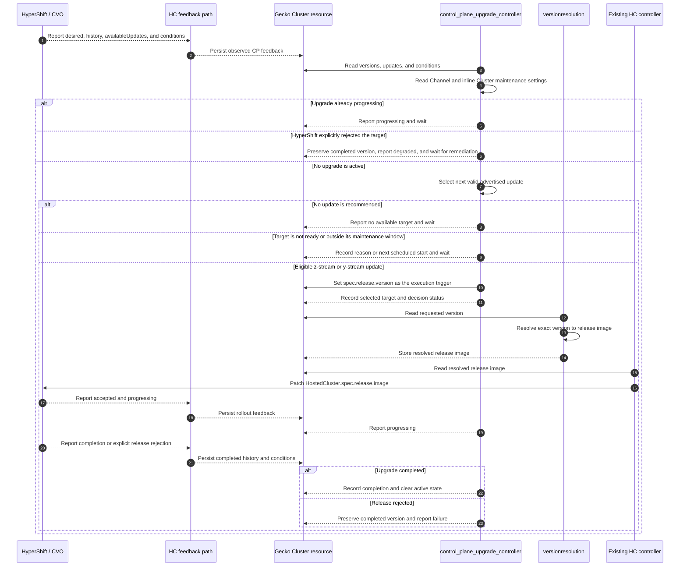
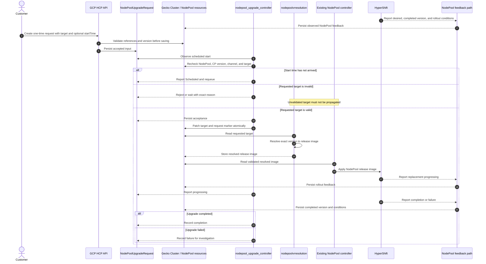

# Hosted Cluster Upgrade Controllers Implementation Plan

## Purpose

Implement safe upgrades for GCP Hosted Control Planes (HCP), building on the [Hosted Cluster Upgrade Policy](../design-decisions/infrastructure/hosted-cluster-upgrade-policy.md). That older decision still describes a separate policy resource and unrestricted z-stream timing; the merged Gecko implementation and the follow-up work described here supersede those details. Update the decision record separately after the remaining product choices are settled.

- Control-plane upgrades are mandatory and platform-managed.
- Customers may start a control-plane upgrade early to an available version.
- NodePool upgrades are customer-triggered.
- Gecko decides when an upgrade may start and which version to request.
- Existing Gecko controllers resolve and apply the release image.
- HyperShift and CVO perform the rollout and report its status.

The implementation is divided into two milestones. Milestone 1 contains three delivery tracks that can be implemented and reviewed independently:

1. Automatic control-plane upgrades for one region, without progressive rollout. Automatic y-stream upgrades are authorized by the Channel fleet minor version.
2. Customer-initiated control-plane upgrades using the same execution and feedback path.
3. Customer-triggered NodePool upgrades.

Milestone 2 adds progressive admission, canary observation, a regional in-flight limit, and pause/resume. Cross-region promotion is a separate later concern; regions remain operationally independent.

### Design updates captured by this plan

This plan separates merged behavior from work still under review:

- [Gecko #387](https://github.com/openshift-online/gecko/pull/387) merged automatic control-plane upgrades. Both z-stream and y-stream starts respect maintenance windows and exclusions; without a window, automatic upgrades may start at any time outside exclusions. A valid, platform-only critical z-stream pin can bypass those timing controls, but not health or upgrade-path checks.
- [Gecko #547](https://github.com/openshift-online/gecko/pull/547) merged maintenance settings into `Cluster.spec.maintenance` and removed the separate `ControlPlaneUpgradePolicy` resource and API. The public Cluster API updates customer timing settings; `criticalUpgrade` is private.
- `Channel.spec.fleetMinorVersion` authorizes automatic y-stream movement. `Channel.spec.installDefaultVersion` is for new Cluster creation, not an upgrade target. An authorized, advertised y-stream candidate currently takes precedence over an ordinary z-stream candidate; the priority may be revisited separately.
- [Gecko #448](https://github.com/openshift-online/gecko/pull/448) proposes one-time manual `ControlPlaneUpgradeRequest` resources. [Gecko #501](https://github.com/openshift-online/gecko/pull/501) proposes immediate or scheduled `NodePoolUpgradeRequest` resources. Neither is merged as of 2026-11-04.
- The 30-day exclusion limit and 48 hours of upgrade availability in every rolling 32-day period remain follow-up validation work. [Gecko #605](https://github.com/openshift-online/gecko/pull/605) is open and must be reconciled with the now-inline maintenance API before it can be treated as implemented.

## Controllers

### `control_plane_upgrade_controller`

Responsible for:

- platform-initiated and customer-initiated control-plane upgrades in Milestone 1;
- selecting the next valid target;
- applying inline maintenance windows and exclusions to automatic upgrades;
- consuming one-time manual requests once that track is merged;
- requesting an upgrade through the Cluster API;
- tracking observed progress and explicit release rejection; a stall deadline and remediation policy remain open.

### `nodepool_upgrade_controller`

Responsible for:

- reconciling one-time immediate or scheduled NodePool upgrade requests;
- rechecking target, control-plane ceiling, channel, and upgrade-step eligibility at execution time;
- recording request acceptance, rollout progress, completion, and failure.

It does not automatically select NodePool upgrades. Skew warnings and out-of-support status remain separate follow-up work, not behavior delivered by the request controller in Gecko #501.

Neither controller performs a rollout. HyperShift and CVO perform the control-plane rollout, while HyperShift performs NodePool replacement.

## Version model

Keep requested and observed versions separate. A requested target is not the current version until HyperShift reports completion.

| Field | Meaning |
|---|---|
| `Cluster.status.hostedClusterResult.version` | Last completed control-plane version observed from HyperShift |
| `Cluster.spec.release.version` | Requested control-plane target; changing it starts resolution and rollout |
| `Cluster.status.hostedClusterResult.desiredVersion` | HyperShift's observed desired control-plane version |
| `Cluster.status.controlPlaneUpgrade.targetVersion` | Target tracked by the control-plane upgrade controller |
| `NodePool.status.currentVersion` (Gecko #501, proposed) | Last completed NodePool version observed from HyperShift |
| `NodePool.spec.release.version` | Requested NodePool target |

The HC or NodePool feedback path owns observed versions. Upgrade controllers consume that feedback and record decisions without presenting a requested version as completed.

The completed version does not change while an upgrade is requested or progressing.

```text
Idle:         completed=4.22.14  requested=4.22.14  HC desired=4.22.14
Requested:    completed=4.22.14  requested=4.23.0   HC desired=4.22.14
Progressing:  completed=4.22.14  requested=4.23.0   HC desired=4.23.0
Completed:    completed=4.23.0   requested=4.23.0   HC desired=4.23.0
```

## Existing OCP version components

| Component | Location | Responsibility | Use in this implementation |
|---|---|---|---|
| Version API | GCP HCP platform API | Caches Cincinnati releases as cluster-scoped `Version` resources. Public clients see version and channel-group membership; the private API also stores the release image | Use for version discovery, cluster-creation validation, and platform support checks; it is not the per-Cluster upgrade-path source |
| Channel API | GCP HCP platform API | Stores platform-managed, Git-configured `installDefaultVersion` and `fleetMinorVersion` values for each channel group | Use the install default for new Clusters and the fleet minor version to authorize automatic y-stream upgrades |
| Cluster version resolution | `gecko/controllers/versionresolution` | Finds an explicitly requested Cluster version in Cincinnati and resolves it to an image | Reuse after a CP target is selected |
| NodePool version resolution | `gecko/controllers/nodepoolvrresolution` | Finds an explicitly requested NodePool version in Cincinnati and resolves it to an image | Reuse after a NodePool target passes validation |
| HyperShift supported versions | `hypershift/support/supportedversion` | Reads the HyperShift Operator `supported-versions` ConfigMap and validates supported versions and skew | Retain as an execution-side compatibility guard |
| HyperShift/CVO available updates | `HostedCluster.status.version.availableUpdates` | Reports recommended updates for a specific Cluster | Use as the Milestone 1 CP target source |

The Version API is a platform-owned cache of Cincinnati release data. It does not identify the valid next upgrade for a particular Cluster. HyperShift/CVO remains the source of cluster-specific recommended upgrade paths.

In Milestone 1, `control_plane_upgrade_controller` selects only from the Cluster's observed `HostedCluster.status.version.availableUpdates`. The Version API does not replace HyperShift's per-Cluster upgrade path; a platform-support check against it is a possible follow-up, not a gate in the merged controller.

The existing Gecko Cincinnati client confirms that an exact version exists and returns its release image. It does not validate upgrade edges. The team should decide whether the existing resolution controllers continue querying Cincinnati or consume the Version API/cache to avoid duplicate integration paths.

## Milestone 1: Control-plane and NodePool upgrade capability

Milestone 1 automatically upgrades each eligible control plane while respecting customer controls. The Channel `fleetMinorVersion` authorizes automatic movement to a newer minor version. It is a fleet target, not a progressive rollout mechanism: every eligible Cluster in the channel can independently start once it passes its own health and maintenance-policy checks.

Customer-initiated control-plane upgrades and customer-triggered NodePool upgrades are also part of Milestone 1.

There is no progressive rollout wave or fleet-wide concurrency gate in this milestone. The Channel fleet minor version is the authorization boundary for y-stream upgrades; it is distinct from the Channel install default version used for new Cluster creation.

Automatic production enablement must be explicit because this behavior can make the entire eligible fleet act on a newly published update.

### 1.1 Control-plane upgrade controller

#### Version API relationship

The platform Version API provides:

- one cluster-scoped `Version` resource per cached Cincinnati release;
- channel-group membership in the public API;
- the release image in the private API for platform consumers;
- snapshot behavior that preserves the last successfully synchronized data when Cincinnati is unavailable.

The Channel API owns the install default version for new Cluster creation and the `fleetMinorVersion` authorization boundary for automatic y-stream upgrades. A Channel change also enqueues existing Clusters in version resolution: it advances each Cluster's concrete HyperShift/Cincinnati channel by at most one minor toward the fleet minor, without changing `Cluster.spec.release.version`. The HC controller applies that channel, CVO refreshes `availableUpdates`, and only an advertised edge can become an upgrade target. An old Cluster therefore does not need a customer edit to notice a new fleet minor or patch update.

Do not add another direct Cincinnati client to `control_plane_upgrade_controller`. The controller selects from HyperShift's cluster-specific `availableUpdates`. The Version API remains available for version listing and cluster-creation validation. The Channel install default is not an upgrade target, and the Version catalog is not an upgrade-edge API.

#### Feedback prerequisites

Use the existing HC-owned `Cluster.status.hostedClusterResult` feedback path to carry:

- `status.version.availableUpdates`;
- `status.version.desired`;
- completed version history;
- `ClusterVersionUpgradeable`;
- `ClusterVersionProgressing`;
- `ClusterVersionAvailable`;
- `ClusterVersionReleaseAccepted`;
- `Available`;
- `Degraded`.

`desiredVersion`, `availableUpdates`, and raw observed conditions remain private platform feedback. The HC controller owns these fields; transport and HC-controller tests should preserve their management-to-region flow without making the cluster-specific upgrade graph a customer-facing contract.

#### Automatic control-plane upgrade sequence



#### Control-plane reconciliation model

The controller follows the Kubernetes reconciliation pattern. Watches enqueue affected Cluster keys; timed requeues ensure the controller evaluates time-based maintenance and observes a rollout even when no new watch event arrives. A Channel change also wakes version resolution, which updates the concrete Cincinnati channel before new HC available-update feedback is selected. Watch events are an acceleration mechanism, not the correctness model.

- Watch Cluster changes directly.
- Map Channel changes to affected Cluster keys. Inline maintenance changes and HC feedback both update the regional Cluster resource, which is watched directly.
- Requeue a Cluster for the next maintenance-window opening, active-upgrade observation, and a periodic safety evaluation.
- Reconcile each Cluster independently. Multiple Cluster reconciliations may run concurrently, but reconciliation must be idempotent and must not start a second upgrade for the same Cluster.

#### Control-plane reconciliation

1. Read one Cluster and its HC-owned HyperShift feedback. Reconcile an already-requested target before selecting another; this observation does not depend on Channel lookup.
2. Treat the last completed HC version as current. Keep `Cluster.spec.release.version` and `status.controlPlaneUpgrade.targetVersion` distinct from it until HC completion is observed.
3. If an upgrade is active, report its observed state and requeue. If `ClusterVersionReleaseAccepted=False`, report the rejection and retain the target for operator investigation; do not automatically roll back or select another target.
4. Otherwise select from this Cluster's observed `availableUpdates` using semantic versions. The z-stream candidate is the newest newer patch in the current major.minor; the y-stream candidate is the next sequential minor permitted by `Channel.spec.fleetMinorVersion`.
5. The merged controller currently prefers an authorized y-stream candidate over an ordinary z-stream candidate. A valid, advertised `criticalUpgrade` pin to a newer patch in the current major.minor takes precedence over either. Z-before-Y priority is a separate unresolved product discussion, not the current behavior.
6. Require `HostedClusterAvailable=True` and positive feedback that `HostedClusterDegraded=False`. Y-stream additionally requires `ClusterVersionUpgradeable=True`. Do not infer health from missing feedback.
7. For both streams, allow a start only inside the configured weekly window and outside exclusions. With no window, starts are unrestricted except for exclusions. A valid private critical z-stream pin bypasses only those timing checks, not health or upgrade-path checks. Closing a window never interrupts an active rollout.
8. Update `Cluster.spec.release.version` using optimistic concurrency. Record the selected target and `targetSource=automatic`; the existing version-resolution and HC controllers apply the image, and HyperShift/CVO performs the rollout.
9. Reconcile until HC feedback reports completion or explicit rejection. A stall timeout, alerting, and safe remediation procedure are follow-up work and must be defined before production rollout.

The controller must be idempotent and recover correctly after restart.

#### Sequential minor upgrades

Control-plane minor upgrades follow valid sequential steps.

```text
Latest channel goal: 4.24
Current:             4.22
Next target:         a recommended 4.23 release
```

After 4.23 completes, the controller reevaluates health and `availableUpdates` before requesting 4.24.

### 1.2 NodePool upgrade controller

#### Feedback prerequisites

Gecko #501 extends the existing NodePool reconciliation path to copy HyperShift's completed version to `NodePool.status.currentVersion` and expose NodePool availability, progress, and health conditions. `NodePool.spec.release.version` remains the requested target, not proof of completion. The proposed request controller records scheduling and rollout state on `NodePoolUpgradeRequest.status`.

#### Customer-triggered NodePool upgrade sequence



#### NodePool reconciliation

1. The customer creates an immutable `NodePoolUpgradeRequest` for a Cluster, NodePool, exact target, and optional one-time `startTime`. The API validates the references and current version rules synchronously where storage-backed validation is available; the controller rechecks at execution time because state may change.
2. Before `startTime`, persist a Scheduled condition and requeue. A scheduled request does not change the NodePool target.
3. Compare the target with `NodePool.status.currentVersion` and the parent's completed control-plane version. Require a newer target, no target above the completed control plane, a supported same-minor/next-minor step or supported EUS-to-EUS step, and membership in the NodePool's channel group in the Version catalog.
4. Persist acceptance before updating the NodePool. Patch `NodePool.spec.release.version` together with a private request marker using optimistic locking so a restart can identify the request that initiated it.
5. The existing NodePool version-resolution and NodePool controllers resolve and apply the image. Observe `NodePool.status.currentVersion` and availability, health, and progressing conditions; complete the request only after they confirm the target is ready.
6. Record rejection, waiting, or failure on request status without moving the completed version prematurely. Skew warnings, out-of-support status, rollout timeout, and an operational remediation policy remain separate work.

NodePool upgrades remain customer-triggered; they do not use the control-plane maintenance window. NodePool skew does not block a mandatory control-plane upgrade.

### 1.3 API changes

Use the following API ownership boundaries:

| Resource or status area | Scope and visibility | Owner and purpose |
|---|---|---|
| `Version` | Cluster-scoped; public version and channel groups, private release image | `version-sync` controller caches Cincinnati data |
| `Channel` | Cluster-scoped; platform-managed and read-only to customers | Git/Argo configuration owns `installDefaultVersion` and `fleetMinorVersion` |
| `Cluster.spec.maintenance.window` and `exclusions` | Public fields on the namespaced Cluster | Customer timing preferences for automatic control-plane upgrades |
| `Cluster.spec.maintenance.criticalUpgrade` | Private field on the Cluster | Platform-only exact z-stream emergency pin; never a customer-settable timing bypass |
| `ControlPlaneUpgradeRequest` (Gecko #448, open) | Namespaced, one-time, customer-created resource | Persists a manual target and its acceptance/rejection decision |
| `NodePoolUpgradeRequest` (Gecko #501, open) | Namespaced, one-time, customer-created resource | Persists an immediate or scheduled NodePool target and rollout conditions |
| `Cluster.status.hostedClusterResult` | Private | HC controller owns desired version, available updates, and raw HyperShift/CVO conditions |
| `Cluster.status.controlPlaneUpgrade` | Public | Control-plane upgrade controller owns target version/source, request/completion timestamps, and failure details |
| `Cluster.status.conditions` with `ControlPlaneUpgrade*` types | Public | Control-plane upgrade controller owns availability, progress, and degraded state |

The separate `ControlPlaneUpgradePolicy` API was removed by Gecko #547. Direct API clients update the Cluster resource to change maintenance settings. A dedicated CLI command may still offer convenient flags, but it must update the Cluster rather than call the removed policy endpoint. Existing `gcphcpctl` policy commands need alignment before they can be used with the new API.

Define separate ownership for observed feedback and controller decisions. Generate public types, schemas, conversions, and deepcopy code using the repository's normal generation workflow.

Coordinate these changes with the Version API contract. Upgrade controllers should consume its stable platform API types instead of defining a second representation of supported release metadata.

### 1.4 Inline maintenance settings

Customer timing preferences live on `Cluster.spec.maintenance`. The following is a fragment of a Cluster resource, not a separate policy object:

```yaml
spec:
  maintenance:
    window:
      startTime: "2026-11-07T02:00:00Z"
      durationSeconds: 14400
      recurrence:
        frequency: weekly
        daysOfWeek: [saturday]
    exclusions:
    - name: holiday-freeze
      startTime: "2026-12-20T00:00:00Z"
      endTime: "2027-01-03T00:00:00Z"
```

The merged API supports weekly recurrence with lowercase day names, a 60-second to 24-hour duration, and at most three named exclusions. Timestamps are UTC. This is a deliberately smaller initial contract than arbitrary RFC 5545 recurrence. A missing window permits automatic starts at any time except during an active exclusion. A window constrains when an upgrade may start; closing it does not interrupt an upgrade already underway.

The public API can clear the window or exclusions through a Cluster update. `criticalUpgrade` is not public: a platform operator may pin an exact, advertised, newer z-stream patch in the current major.minor to bypass only the window and exclusions. The controller still requires a valid upgrade edge and healthy HostedCluster. The pin is not a way to force a y-stream upgrade. The current selector evaluates the pin only after a successful Channel lookup; its behavior when the Channel is missing needs a focused fix or an explicit fail-closed decision before emergency use is relied upon.

The older design also calls for a maximum 30-day exclusion and at least 48 hours of upgrade availability in every rolling 32-day period. Those combined checks are not in the merged inline API yet; Gecko #605 is follow-up work that needs rebasing to this contract. The four-hour minimum window and EOL-proximity timing override remain product decisions rather than behavior to claim as implemented.

### 1.5 Customer-initiated control-plane upgrades

Gecko #448 proposes an immutable, one-time `ControlPlaneUpgradeRequest` with `spec.clusterID` and an exact `spec.targetVersion`. It remains an open PR; the manual API and controller behavior below are the proposed implementation, not merged production behavior.

1. The customer creates the request through the nested Cluster API. The public API checks the referenced Cluster, observed completed version, absence of an active target, and exact membership in that Cluster's HC-observed `availableUpdates` before saving, returning an immediate validation error where a check fails.
2. The controller rechecks the advertised target and health before acting, because conditions can change after API admission. A y-stream target requires `ClusterVersionUpgradeable=True`.
3. A manual request may start outside the automatic maintenance window or exclusions. This is an intentional distinction from automatic upgrades; it does not bypass health, version-path, or concurrency checks.
4. Persist request acceptance before updating `Cluster.spec.release.version`. The existing version-resolution and HC controllers then apply the image; HyperShift/CVO performs the rollout. Request status records Accepted or Rejected, while rollout progress and `targetSource=customer` remain on Cluster status.
5. An active automatic or manual rollout is observed to completion before another target is considered. At steady state, accepted/pending manual work is considered before selecting a new automatic target. A manual request does not preempt an upgrade already in progress.

The current request contract has no scheduled start time. A scheduled manual control-plane request and a customer-facing per-Cluster available-upgrades endpoint are possible follow-ups, not prerequisites to the one-time request API.

### 1.6 Failure and status-update safety

For both upgrade paths, preserve the last completed observed version while a target is pending or failed. Do not automatically downgrade. An explicit HyperShift release rejection leaves the control-plane target in place and the Cluster degraded, stopping automatic selection of another target. Whether and when a stuck upgrade becomes terminal, how an operator clears a failed target, and how to prevent immediate reselection require a separate remediation design; do not describe automatic rollback or a stall deadline as implemented.

Operational metrics, alerts, and customer notifications are required before broad production enablement. The NodePool request controller's proposed failure conditions do not yet amount to a complete HyperShift rollout-failure or stall policy.

Each status field and condition has one owning controller.

| Owner | Fields and conditions |
|---|---|
| HC controller | `Cluster.status.hostedClusterResult`, including HostedCluster availability, observed desired/completed versions, available updates, and raw CP feedback |
| Cluster version-resolution controller | Resolved Cluster release information and `VersionResolved` |
| `control_plane_upgrade_controller` | `Cluster.status.controlPlaneUpgrade` and `ControlPlaneUpgrade*` conditions, including durable last-result data, target version/source, request/completion timestamps, and failure details |
| NodePool feedback path | Observed completed NodePool version and rollout conditions; the requested target stays in NodePool spec |
| NodePool version-resolution controller | Resolved NodePool release information and `NodePoolVersionResolved` |
| `nodepool_upgrade_controller` (proposed) | `NodePoolUpgradeRequest.status` scheduling, acceptance, progress, completion, and failure conditions |

Each writer must modify only its owned fields and preserve other controllers' status. Spec changes use resource-version optimistic locking and re-evaluate eligibility on conflict. Request acceptance is persisted before applying a manual or NodePool target so restarts can resume without issuing a second upgrade.

### 1.7 Deployment and validation

The control-plane controller has a dedicated Gecko Helm chart, and [gcp-hcp-infra #2435](https://github.com/openshift-online/gcp-hcp-infra/pull/2435) merged its regional Argo application. The proposed NodePool request controller has a separate chart in Gecko #501; its [infra wiring](https://github.com/openshift-online/gcp-hcp-infra/pull/2432) is still a draft. Deployment in Dev AIO is not evidence that an open controller PR is enabled in integration or production.

Keep the controllers independently deployable so each can be rolled out, scaled, monitored, and disabled separately. Start each dedicated Deployment with one replica. Controller-runtime workers can reconcile different Cluster keys concurrently, but the worker count is not an in-flight upgrade limit. The design must not use a single in-memory fleet loop or require one pod per customer Cluster.

For each controller, add:

- reconciler package and tests;
- command/subcommand wiring;
- resource watches;
- RBAC permissions;
- a dedicated Helm chart consistent with existing Gecko controllers;
- health and readiness probes when a meaningful controller health endpoint is available;
- resource requests and limits;
- environment-specific configuration.

The controllers do not need finalizers solely to track an upgrade request; they do not own an external resource that requires deletion cleanup. Reconciliation and status updates must remain safe across pod restarts and repeated delivery of the same key. Current chart templates do not yet render health probes, so probe implementation is a follow-up rather than a claimed deployment feature.

Test at least:

- successful z-stream and y-stream CP upgrades;
- maintenance-window and exclusion behavior;
- sequential minor upgrades;
- valid and invalid NodePool targets;
- NodePool skew warning, out-of-support state, and support restoration;
- explicit release rejection and a separately designed stalled-upgrade policy;
- controller restart and duplicate reconciliation;
- stale or unavailable feedback;
- concurrent status-update conflicts;
- overlapping manual and automatic CP requests;
- multiple eligible Clusters.

Before broad production enablement, provide metrics, alerts, customer events, dashboards, and remediation runbooks. Since the current automatic controller has no progressive admission gate, enabling it for an entire region allows all individually eligible Clusters to start concurrently.

## Milestone 2: Progressive delivery

Milestone 2 limits simultaneous upgrades and expands exposure only after observing canaries. Its first scope is within one management cluster/region, not a cross-region orchestrator. Different regions remain independent; cross-region promotion can be designed later. The per-Cluster target still comes from that Cluster's HC-observed upgrade path.

### 2.1 Progressive-rollout admission

The Channel `fleetMinorVersion` remains the platform-managed authorization boundary for automatic y-stream upgrades. It is distinct from the Channel install default version and is not inferred from the latest version in Cincinnati.

```text
Cluster current version: 4.22.12
Channel fleet minor:     4.23
HyperShift candidate:    4.23.7
Progressive admission:   permitted for this Cluster
```

Add admission after per-Cluster target, health, and customer timing checks and before the spec version write. It applies to automatic z-stream and y-stream upgrades. Once manual requests exist, they must count against the same regional capacity; whether they can bypass the canary stage is an explicit product decision. A critical maintenance override bypasses only customer timing, not path validity, health, capacity, canary stage, or a rollout pause.

```text
Per-Cluster CVO update edge and target selection
        |
Channel fleet minor permits a y-stream target
        |
Health and customer timing permit start
        |
Regional capacity and canary stage admit this attempt
        |
Upgrade requested; reservation held through observation
```

The proposed regional admission state needs durable, conditional reservations so concurrent controller workers or replicas cannot exceed the in-flight limit. A reservation identifies the Cluster UID, source and target, and attempt; a restart must recover it. Keep an uncertain reservation occupied until a safe reconciliation or operator action proves it can be released. The exact resource schema and storage guarantees are design work, not part of Milestone 1.

### 2.2 Progressive rollout

Define and automate:

- platform-owned regional canary selection and a single regional capacity limit across channels and sources;
- target-correlated canary evidence, including the actual payload identity, so success for one release never unlocks another;
- a continuous-health soak after HyperShift reports completion before the slot is released or the next wave is admitted;
- explicit timeout, failure thresholds, and a durable pause on rejection, stalled progress, or unhealthy soak;
- operator-owned investigation and resume, with no silent automatic unpause;
- rollout metrics and dashboards.

Pause stops new admissions; it cannot retract an upgrade already authorized and started. Canary selection must never force a Cluster to a version absent from its own recommended updates. Environment-to-environment or cross-region promotion is separate from this first regional gate.

### 2.3 Cincinnati emergency controls

Document how to disable an unsafe upgrade path in Cincinnati, including the use of conditional edges where appropriate.

The operational procedure must identify:

- who can request an edge change;
- how an affected version or path is identified;
- how quickly the change reaches CVO clients;
- how already-started upgrades are handled;
- how the path is restored after remediation.

Cincinnati edge controls stop new affected upgrades. They do not replace the platform-side progressive gate, which limits blast radius before a fleet-wide problem occurs.

## Delivery order

1. Merged: HC feedback, Channel/Version foundations, automatic control-plane controller, inline Cluster maintenance, and its regional Argo application.
2. Open: manual `ControlPlaneUpgradeRequest` API/controller and CLI integration.
3. Open: immediate/scheduled `NodePoolUpgradeRequest` API/controller, CLI, and regional deployment.
4. Follow-up: inline exclusion-duration and rolling-availability validation; CLI maintenance command alignment; critical-pin behavior with a missing Channel; failure/stall remediation; observability and runbooks.
5. Milestone 2: regional canary admission, durable capacity, soak, pause/resume, and Cincinnati emergency runbook.
6. Later: cross-region promotion, customer notifications, and production enablement after the gates and operations model are proven.

## Open team decisions

### Milestone 1

1. Should normal z-stream candidates take priority over authorized y-stream candidates? The merged implementation currently favors y-stream; this remains a separate discussion.
2. Should every Cluster require a maintenance window, or does the merged no-window-means-anytime contract remain? If a default is required, define a schedule that satisfies the rolling-availability requirement.
3. How should the 30-day exclusion and 48-hours-in-32-days validation be adapted to the inline Cluster API? Is a four-hour minimum window a product requirement?
4. Do version-resolution controllers continue querying Cincinnati, or consume the Version API/cache? Should the Version API expose upgrade paths or only catalog membership?
5. Which NodePool upgrade-step and EUS/skew rules must be enforced synchronously, and where are skew warnings and out-of-support status exposed?
6. What defines a stalled control-plane or NodePool upgrade, and who owns retry, failure alerting, and remediation without an unsafe rollback or immediate reselection?
7. Which public, authorization-filtered API should eventually expose a Cluster's available upgrade targets?

### Milestone 2

1. What durable regional admission schema, conditional storage guarantees, and reservation recovery protocol enforce one shared capacity limit?
2. How are canaries selected, how long is healthy soak, and what failure or timeout thresholds latch a pause?
3. Who owns regional emergency stop/resume and Cincinnati edge-change procedures?
4. How is later cross-region promotion coordinated without violating regional independence?

### Customer-initiated upgrades

1. May customer-initiated upgrades bypass a future automatic canary stage? They must still count toward regional capacity and obey health and path checks.
2. Should one-time manual control-plane requests gain an optional future start time, and if so how does it interact with automatic selection?

## Upgrade readiness source

HyperShift and CVO are authoritative for whether a particular control plane is ready to upgrade. Gecko consumes the conditions exposed on the HostedCluster instead of recreating CVO's component-level readiness checks.

Before selecting a new target, the merged controller requires:

- completed HC feedback and no already-active spec/HC target;
- `HostedClusterAvailable=True` on the regional Cluster;
- observed `HostedClusterDegraded=False`;
- the selected target in that Cluster's HC-observed `availableUpdates`;
- for y-stream only, observed `ClusterVersionUpgradeable=True`.

If `ClusterVersionUpgradeable` is false or unknown, Gecko records its reason and message and waits. It does not reproduce or override CVO's component-level validation.

For a z-stream upgrade, Gecko does not require `ClusterVersionUpgradeable=True`. It still requires an advertised target, no active upgrade, and the same availability and degradation gates. A missing or unknown health signal blocks selection.

Automatic z-stream and y-stream starts also obey the inline maintenance window and exclusions unless a valid platform-only critical z-stream pin applies. The manual request track is different: it may bypass customer timing but not the upgrade-edge or health gates.
